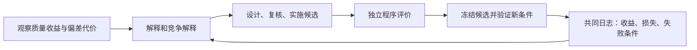

# 当前唯一主工程入口（2026-10-17）

后续研发请进入 `/data/cjh/rsi/project`，只使用 `rsi_researcher` 包。
旧 outputs/、experiments/ 和冻结 releases/ 都是历史证据，不是新版本源代码入口。

- 当前架构：[ARCHITECTURE_CURRENT](docs/ARCHITECTURE_CURRENT.md)
- 下一阶段研究：[RESEARCH_ROADMAP_CURRENT](docs/RESEARCH_ROADMAP_CURRENT.md)

命令：

```bash
cd /data/cjh/rsi/project
/data/cjh/rsi/envs/research/bin/python -B -m rsi_researcher bias-tasks
/data/cjh/rsi/envs/research/bin/python -B -m rsi_researcher bias-coat --output runs/my-new-coat
/data/cjh/rsi/envs/research/bin/python -B -m rsi_researcher bias-exposure --output runs/my-new-exposure
/data/cjh/rsi/envs/research/bin/python -B -m rsi_researcher bias-coat-sensitivity --output runs/my-new-sensitivity
/data/cjh/rsi/envs/research/bin/python -B -m rsi_researcher bias-exposure-sim --output runs/my-new-exposure-synthetic
/data/cjh/rsi/envs/research/bin/python -B -m rsi_researcher bias-decision-freeze --output runs/new-frozen-decision-task
/data/cjh/rsi/envs/research/bin/python -B -m unittest discover -s tests -t .
```

以上 Bias 子命令只运行 CPU 开发证据；不会启动新 Qwen、调用 GPU 或评价确认标签。
原有 author-check、study、run、validate 命令依旧存在，按各自配置可能实际调用模型。

---

## 历史 README（2026-10-15，原样留存）

# 推荐系统研究员（RSI Researcher）

**当前推进范围（2026-10-15）：只用 AgentCF 作者的 CDs-100-user-dense 数据与本地 Qwen3-8B。** 真实入口是 `author-check`，不是人工场景配置 `qwen_agentcf.json`，也不是下面保留的历史 ItemCF `study`。

在服务器 `/data/cjh/rsi/project` 中，启动项目自己的 vLLM 服务后运行：

```bash
python -m rsi_researcher author-check --config configs/qwen_agentcf_author.json --output runs/qwen-author-check
```

默认检查 2 名用户、每人 5 条真实训练事件，按作者配置使用 **9 个陪选＋1 个目标**。输出 `report.md`、数据说明、每条记忆更新和实际请求日志。只读 train/valid，不读取 test；不会退回付费后端。这一步确认真实流程可运行，不能证明去偏或 RSI。详细说明见 [AgentCF 实际推进](docs/AgentCF实际推进_2026-10-15.md)。

以下第五、六版内容保留为历史记录，其中 Coat、KuaiRand 和人工世界均不用于当前实际实验。

第六版增加 Qwen3-8B 自部署后端。先读 [服务器部署与接入](docs/Qwen3-8B部署与后端替换.md) 和 [真实流程改进说明](docs/真实流程改进说明_2026-10-15.md)。`study` 默认使用 Qwen 新配置；旧 DeepSeek 配置仍保留用于复核原实验。两者的代码、实际状态和结果分别记录。

```bash
python -m rsi_researcher check-model --config configs/qwen_backend_comparison.json --output runs/qwen-check
python -m rsi_researcher study --config configs/qwen_research_v2.json --output runs/qwen-study
```

这两条连接已启动的本地 vLLM 服务，不会回退到 DeepSeek。Qwen 服务尚未就绪时不要启动整批研究。

第五版增加官方真实数据研究入口。使用 Cornell 作者发布的 Coat 和 KuaiRand 官方随机曝光数据，传统 ItemCF 推荐器在 CPU 上执行；真实模型负责提出假设、选择改法、阅读实际结果和修订下一任务的研究策略。已完成真实模型研究与独立评分，主批和补充检查合计 30 次请求。第五版源码当时 **176 项程序检查通过**；检查与研究效果见[实际验证报告](docs/真实数据验证报告_2026-10-14.md)；通过流程检查不等于已证实 RSI。

```powershell
python -m rsi_researcher fetch-data --dataset coat --output data/external/coat
python -m rsi_researcher fetch-data --dataset kuairand-pure --output data/external/kuairand-pure
python -m rsi_researcher study --config configs/official_study.json --output runs/my-official-study
```

前两条只下载及核验公开数据，第三条会调用付费模型，默认最多 30 次请求（包括重试）。密钥由当前进程的 `DEEPSEEK_API_KEY` 提供；Windows 已保存用户变量时可在本机终端先执行 `$env:DEEPSEEK_API_KEY = [Environment]::GetEnvironmentVariable('DEEPSEEK_API_KEY','User')`，值不需要打印。

先读 [真实数据应用说明](docs/真实数据应用说明.md) 和 [官方数据选择](docs/官方数据选择.md)。本版比较带历史研究员、无历史研究员及固定改法，并把实际生成的研究策略迁移到第二份数据，与原策略使用相同轮数。真实数据只评价已观察的随机候选面板；缺失评分不补成负例。推荐器改善、自主研究闭环和研究策略改进分别记录，不能因流程完成就宣称 RSI 成立。

从 AgentCF 出发，研究“推荐变好了，为什么也更偏向热门物品”，并让 Agent 根据实验结果继续查原因、提出改法、验证效果。

项目按职责组织为一个 Python 包。研究流程、被研究的推荐器、独立评分、数据和模型接口分别放在自己的目录；测试、配置和说明也独立存放。统一入口是 `python -m rsi_researcher`。

## 先运行一个完整的离线闭环

在项目根目录运行：

```powershell
python -m pip install -r requirements.txt
python -m unittest discover -s tests -t .
python -m rsi_researcher demo --output outputs/structured-demo
```

演示使用固定回复，不读取 API 密钥、不联网、不产生模型费用。输出路径必须是新目录。它依次执行：

1. **开发快环**：提出解释和竞争解释，设计候选，执行并评分。
2. **独立验证环**：冻结已有候选，在 4 个事先指定的新环境中分别比较原版与候选。
3. **证据回流**：把验证结果写进共同日志，再运行一轮研究，检查下一轮是否确实读到这些结果。

演示证明程序连接正确，不能证明真实模型具有研究能力，也不能证明去偏已经有效。程序检查数量和最新通过情况见本次交付验证记录。

## 目录与责任

```text
rsi_researcher/
├─ __main__.py、cli.py       统一命令入口
├─ paths.py                 统一查找配置和数据
├─ research/                问题、候选、证据、日志与独立验证
├─ recommenders/            AgentCF、笔记依赖与修复执行
├─ evaluation/              固定规则评分与结果分析
├─ datasets/                可控研究环境和作者输入
├─ runtime/                 真实/离线模型、预算与源码快照
├─ experiments/             成组机制实验、历史试运行工具
└─ diagnostics/             排名格式和模型接口专项检查
tests/                      程序检查
configs/                    开发配置、独立验证协议
data/                       小数据、作者提示词及来源说明
docs/                       代码导读、工作流解释与论文对照
scripts/build_code_bundle.py  完整源码打包与核验
pyproject.toml              项目依赖与命令声明
```

研究流程调用实验工具，工具调用推荐器；评分程序用固定评价规则检验结果。模型提出解释和改法，程序保存实际状态与排名，模型不能替自己改分数。新增一种推荐改法，应集中修改候选执行模块，而不是同时重写整个研究流程。

## 明确对照 Google 的工作

参考工作是 [Self-Evolving Recommendation System: End-To-End Autonomous Model Optimization With LLM Agents](https://research.google/pubs/self-evolving-recommendation-system-end-to-end-autonomous-model-optimization-with-llm-agents/)。逐节借鉴和适配说明见 [Google工作对照](docs/Google工作对照.md)。

| 借鉴点 | 本项目的具体实现 |
|---|---|
| 快环快速提出并检验候选 | `research/workflow.py` 组织诊断、设计、复核、执行、评分与总结。 |
| 慢环在不同条件下验证候选 | `research/validation.py` 冻结动作与参数，在预定新环境重新执行原版与候选。 |
| 两环共享实验历史 | `research/journal.py` 关联候选、失败证据和验证结果，提供下一轮研究历史。 |
| 修改学习组件时保留固定评价 | 推荐规则可以改，`evaluation/` 的质量与偏差评价保持独立。 |

Google 工作的慢环包括真实线上用户实验；这里实现的是**独立验证环**。我们尚无真实线上流量，不能把换模拟种子称作在线 A/B，也不能继承该论文的生产效果。

本项目面向推荐系统研究员：不只问“分数有没有提高”，还问“是否引入偏差、哪种解释成立、怎样用对照推翻解释”。AgentCF 是第一种研究对象，不是预设的最终算法。

## 一次研究怎样走完



四类研究职责是诊断、设计、反证复核和总结。当前可以由同一个模型在不同步骤扮演，靠结构化记录交流。研究员看到的证据包含逐条推荐变化和笔记变化，隐藏偏好参照只供评分使用。

目前已实现的动作包括未知反馈保护、笔记依赖重放、固定热门重排、切断共享和交换输入位置。它们是研究工具；选择一个动作或更换提示词，本身不足以证明论文创新。探索需要新曝光和真实反馈，固定日志不能凭空提供；跨环境依赖重放还需要可迁移的根事件选择规则。

## 怎样读演示结果

打开 `outputs/structured-demo/report.md`，再按下面的顺序读：

| 目录或文件 | 看什么 |
|---|---|
| `trials/0001`、`trials/0002` | 快环为什么提出候选、实际改了什么、哪些结果支持或反驳解释。 |
| `validation/report.md` | 4 个新环境各自的质量、偏差和执行情况，不能只看平均值。 |
| `journal.json` | 同一候选的开发与验证证据怎样关联。 |
| `next_discovery/trials/0001` | 后续研究是否读到了验证反馈。 |
| `archive.json` | 各轮记录与两个环的执行汇总。 |

`execution_status` 说明程序有没有完成；`research_status` 说明研究得到了什么结论。跑完也可能得到“证据不足”或“改法不成立”。复用同一实验结果会注明来源，不算新的独立重复。

## 真实模型运行

下面命令会调用付费模型。密钥从当前进程的 `DEEPSEEK_API_KEY` 环境变量读取，不写入源码和配置。

```powershell
python -m rsi_researcher run --config configs/research_workflow.json --output runs/my-discovery --journal runs/journal.json
python -m rsi_researcher validate --source runs/my-discovery --trial 0002 --protocol configs/validation.json --output runs/my-validation --journal runs/journal.json
python -m rsi_researcher journal --path runs/journal.json
```

`run` 运行开发快环；`validate` 独立验证指定候选；同一个 `--journal` 让下一批研究读到已有开发与验证证据。候选轮次必须对应实际存在的产物。给 `validate` 增加 `--offline` 可以用固定回复检查流程。`inspect` 回看已有结果，不调用模型。各命令参数可通过 `--help` 查看。

依赖见 `requirements.txt`。`python -m pip install -e .` 可以增加 `rsi-researcher` 短命令；这是可编辑安装，仍从源码工程读取配置和小数据。当前交付方式是完整源码包。

## 阅读路线与代码交付

1. [代码导读](docs/代码导读.md)：从入口到两个环，解释每个模块读什么、做什么、留下什么。
2. [Google工作对照](docs/Google工作对照.md)：论文的设计、本项目的适配、尚未实现的能力。
3. [研究员工作流说明](docs/研究员工作流说明.md)：研究目的、偏差分类、AgentCF 与研究问题。
4. [数据与作者来源](data/README.md)：输入的来源和使用限制。

生成保留目录结构的完整代码包：

```powershell
python scripts/build_code_bundle.py --offline-demo outputs/structured-demo
python scripts/build_code_bundle.py --verify outputs/<实际包名>.zip
```

包内包括业务源码、全部测试、配置、文档、作者小数据和明确标记的离线演示；不包括真实请求日志、密钥、历史输出、论文 PDF 和完整作者仓库。`source_manifest.json` 记录每个文件的指纹，供 ZIP 内文件核验。

下一步研究重点是检验真实模型看到反证后是否改变下一项实验，并与固定规则、单角色和无历史版本比较。结构化源码和双环连接是研究基础，还不是稳定去偏收益或自主算法发现的实验结论。

## 最新 Cross-Bias 研究试验

见 docs/CROSSBIAS_DISCOVERY_PILOT_20261017.md。科研 Agent 真实提出假设、选择 Coat/AgentCF 反证，独立执行与审计已完成。严格的独立科学发现数仍为 0，不能认为 RSI 已被证实。源码与结果均已记录；Qwen 服务退出、GPU 已释放。
