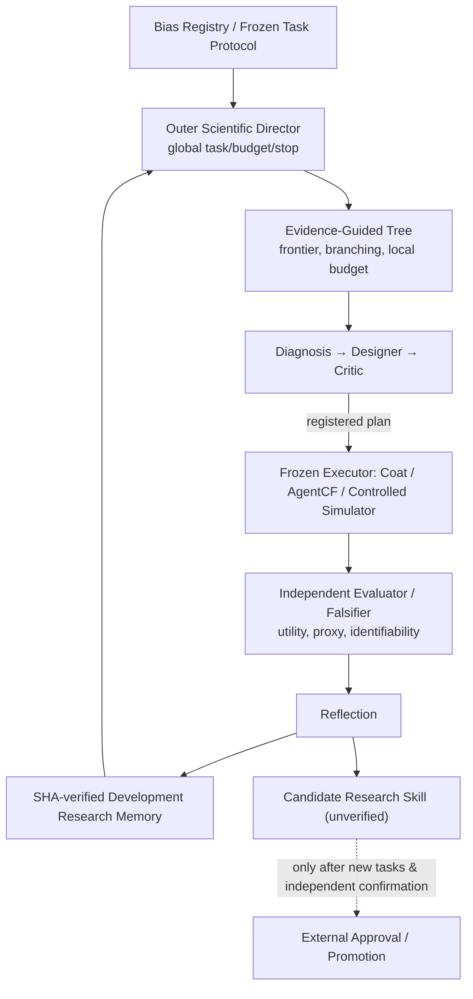

# RSI 当前唯一研究架构（2026-10-20）

本文件描述 `main` 上的当前科学工作流，不覆盖历史原始运行与旧报告。代码合并提交点为 `746a849`，主工程为 `/data/cjh/rsi/project`。

## 设计裁决

- **偏差定义**：`bias_registry.py` / `configs/bias_tasks.json` 独占五类 Bias 的科学语义和任务前提。AgentCF Memory/Position/Conformity 是机制研究，不作为第六种正式 Bias。
- **研究智能体**：Diagnosis（解释和竞争假设）、Designer（可证伪行动/数值预测）、Critic（识别与混杂审查）、Reflection（基于独立数值审计生成条件性经验）。这是四种结构化真实 Qwen 调用，不是四个孤立脚本。
- **单回合权威**：`scientific_loop.py` 负责冻结计划、证据边界、执行合法性和预算；`scientific_experiments.py` 拥有数值执行/判断；LLM 不计算自己的真值。
- **两层调度**：`scientific_tree.py` 保存多候选与失败分支；`scientific_director.py` 按已注册任务和实际资源上限安排连续轮次，停止条件明确。不创建新的总控 Agent。
- **科研证据所有权**：只有绑定原始路径/SHA256 和独立数值结果的已核验**开发证据**进入后续科研 Memory；`scientific_skills.py` 的自动科研策略仍是候选，不会自动晋升。
- **公平性与独立确认**：`five_bias_development.py` 的开发评分与 `selection_confirmation.py` 的冻结单次保留集处于不同证据等级。显著性与跨任务优越性需未来另行预注册。

## 总架构

## 执行证据的等级

1. **软件实现**：合法 schema、模型真实调用、冻结执行、审计日志、预算停机；真实 Qwen 证据已具备。
2. **开发期机制或预测证据**：Coat、KuaiRand 随机参考、AgentCF 和匹配合成世界已经有结果，也有反例和弃权。
3. **冻结独立确认**：Coat Selection cap=100 单次保留集未达到预注册联合质量约束；不能在该保留集继续调参寻找正结果。
4. **未见数据科学发现和 RSI 优越性**：尚无严格、可迁移且经统计控制的独立确认；真实发现计数保持 0。

## 依赖和数据边界

- `datasets/coat.py`：6,960 条非随机训练评分、随机评分开发 2,065 条、保留 2,209 条。Coat 的 0 表示未观察评分，不是负例。
- `datasets/kuairand.py`：标准与随机曝光双日志；共享 item×tab 支持集审计，绝不编造 propensity。
- `recommenders/agentcf.py`：原作者 CDs 模拟交互、User/Item Memory 与固定状态排名；User/Item Memory 是被研究的行为，不等于新的 Research Memory。
- `research/feedback_pair_control.py` / `exposure_synthetic.py`：可操控机制真值的受控世界；不能以模拟结论替代真实世界因果证据。
- 配置与新运行结果分别留在 `configs/`、`runs/`。旧 `releases/`、日期化报告和此前开发工作树保留为可追溯历史，不用删真实科学证据换取文件数量好看。

## 哪些还不是完整成果

POPPER 式 Type-I 错误控制、AutoDebias 官方强基线复现、独立未见数据对照、纵向真实 Filter Bubble 可识别性、完善的 Skill promotion 都还没有完成。参考 `RESEARCH_ROADMAP_CURRENT.md`。
