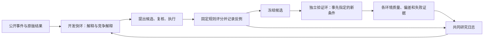

# 从代码理解“推荐系统研究员”

这份项目研究的是：推荐器从行为中学习后，为什么推荐质量可能提高，却更偏向热门物品；研究 Agent 能否发现这个代价、提出可被推翻的解释、设计对照，并据结果改变下一步。

原来的平铺脚本可以验证想法，但没有把“研究员”“被研究的推荐器”“独立评分”从目录和入口上分清。这次改为一个真正的 Python 包，把源码、测试、配置、说明和交付工具分别组织。Python 仍是实现语言，变化在于各部分有明确责任和调用关系。

## 1. 先运行，再读代码

在源码包解压后的根目录运行：

```powershell
python -m pip install -r requirements.txt
python -m unittest discover -s tests -t .
python -m rsi_researcher demo --output outputs/structured-demo
```

第一条安装唯一的运行依赖 `jsonschema`，用于检查模型回复是否符合程序要求。第二条运行程序检查。第三条用固定回复演示开发快环和独立验证环，不读取密钥、不调用网络。输出目录必须是新目录，保留以前的实验。

先看演示目录的 `report.md`，再看 `trials/0001`、`trials/0002` 的快环记录、`validation/` 的 4 个新环境验证，以及 `next_discovery/trials/0001` 的反馈后研究。三段共用 `journal.json`；根 `archive.json` 保留快环记录并增加各环汇总。`runtime/offline.py` 预先写好了演示回复，用来检查“候选能否进入验证、下一轮是否确实读到验证证据”。它不能证明真实模型会自主研究，也不能证明去偏有效。

统一入口是 `python -m rsi_researcher`。如果要使用更短的 `rsi-researcher` 命令，可以在源码根目录运行 `python -m pip install -e .`；这是可编辑安装，命令仍使用当前源码及同目录的数据和配置。当前交付是完整源码工程，不宣称单独的 wheel 安装包已经携带默认研究数据。

## 2. 目录为什么这样分

```text
项目根目录/
├─ rsi_researcher/              业务代码：推荐系统研究员
│  ├─ __main__.py              python -m 的入口
│  ├─ cli.py                   命令参数与运行模式
│  ├─ paths.py                 统一寻找项目资源
│  ├─ research/                研究问题、候选、证据与验证
│  │  ├─ benchmark.py          真实数据研究、候选冻结及策略迁移
│  │  ├─ workflow.py           开发快环调度
│  │  ├─ operators.py          已实现的候选改动
│  │  ├─ baseline.py           固定原版与来源检查
│  │  ├─ evidence.py           逐条推荐与笔记变化
│  │  ├─ journal.py            跨批次研究日志
│  │  └─ validation.py         冻结候选的独立验证环
│  ├─ recommenders/            AgentCF 与 CPU ItemCF 被研究对象
│  ├─ evaluation/              独立评分与结果分析
│  ├─ datasets/                fetch 下载；coat/kuairand 读取；controlled 模拟环境
│  ├─ runtime/                 模型接口、离线替身、预算与源码快照
│  ├─ experiments/             成组实验与旧试运行入口
│  └─ diagnostics/             接口、排序格式等专项检查
├─ tests/                      程序测试，与业务源码分开
├─ configs/                    快环和验证协议
├─ data/                       小数据、作者提示词、来源说明
├─ docs/                       工作流说明、论文对照、代码导读
├─ scripts/build_code_bundle.py  完整源码交付工具
├─ pyproject.toml              项目名、依赖和命令入口
└─ README.md                   第一个阅读入口
```

`research` 表示研究过程；`recommenders` 表示被研究的推荐器；`evaluation` 表示检验结果的尺子。三者分开之后，研究角色可以提出改法，但不能顺便改评分答案。新增推荐算法应进入推荐器或候选实现，不需要把打包、评分和研究调度一起改掉。

`runtime` 只提供执行资源，不决定哪种去偏解释更可信。`diagnostics` 是专项工具，不会混在主要研究流程里。根目录不再摆放一排业务和测试脚本。

## 3. 对照 Google 的工作，究竟借鉴了什么

对应的是 Google 的《Self-Evolving Recommendation System: End-To-End Autonomous Model Optimization With LLM Agents》。详细原文位置和逐项对应见 [Google工作对照.md](Google工作对照.md)。

借鉴的重点是：快速形成候选、把候选送入更独立的验证、通过持久日志把结果送回研究过程。Google 工作的慢环包括真实生产线上实验；本项目没有这些流量，因此实现的是**开发快环 + 独立验证环**。换一个模拟环境，不能叫线上 A/B。

我们的目标还增加了偏差研究：不能只寻找更高推荐分数，还要解释收益有没有偏差代价、改法为何可能有效、哪些结果会推翻解释。当前候选动作是预先实现的，尚未实现阅读任意推荐器源码后自动生成新算法。



飞轮在这里的具体含义是：下一轮不只读上一轮的结论，还能读到验证中的失败与限制，从而改变研究问题或对照。是否真的改变了决策，需要用真实模型的反证实验验证，不能因为存在一个日志文件就宣布完成。

## 4. 顺着一次运行读代码

### 入口与资源

`__main__.py` 把命令交给 `cli.py`。`cli.py` 选择演示、开发、验证或已有结果回看，读取配置，再调用相应业务模块。`paths.py` 集中寻找配置和数据，业务模块不再各自猜“向上几层才是根目录”。

`runtime/client.py` 负责真实模型请求及回复检查；`runtime/offline.py` 实现同样的调用入口，但给出固定演示回复。它们只负责“返回什么”，不负责评价候选是否科学有效。`runtime/limits.py` 维护一批实验共同的请求、文本量和时间上限；这里的 token 是模型处理文本的计量单位。

`runtime/source_snapshot.py` 保存本次实际使用的源码。这样读到旧结果时，能找到当时运行的版本，不必猜当前代码是否已经改过。

### 真实数据入口

第五版从 `study` 命令进入 `research/benchmark.py`。完整数据读取、研究员决策、外部评分和策略迁移的逐步代码说明见[真实数据应用说明](真实数据应用说明.md)。它使用真实观察反馈；下面的 AgentCF 模拟环境快环是另一条研究路径，不能混用效果结论。

### 开发快环

`research/workflow.py` 的 `run_cycles` 组织多轮开发，`run_research` 组织一轮研究：

1. 从同一研究环境和原版结果出发，观察质量与偏差的冲突。
2. 诊断角色提出主要解释、竞争解释及缺失证据。
3. 设计角色把解释变成具体动作、预期方向和反证条件。
4. 复核角色判断这个对照能否回答问题，也可以建议保留原版。
5. 普通程序执行动作、评分、整理实际变化。
6. 总结角色根据结果更新判断和下一步计划。

目前四类研究角色可以使用同一个模型接口，每一步有独立的输入和输出要求。“交流”通过明确的记录传递，不是四个分别训练的模型，也不是四个进程互相聊天。

`research/baseline.py` 准备共同的原版参照。B0 的意思就是“不加本次新改法的原版”。复用旧 B0 时同时核对环境、事件、提示词和已知执行设置，避免不同条件的成绩混在一起。未知设置保持未知。

`research/operators.py` 将已复核计划转为实际动作。`execute_candidate` 负责执行，`execution_key` 判断是否与同批固定原版下已经完成的实验相同。同一改法换一个问题描述，不必重复训练；复用的结果会注明来源，不能当成新的独立重复。

`research/evidence.py` 的 `build_candidate_evidence` 整理逐条推荐的得失、笔记变化和实际执行事实。`compact_candidate_evidence` 产生给研究角色阅读的有限摘要，同时保留损失与偏差增加，避免只展示赢家。

### 独立验证环

`research/validation.py` 的 `run_validation` 接收已经形成的候选和事先写好的验证协议。进入这一环时，候选动作和参数冻结；对每个新环境分别生成原版、执行候选，再按固定评价方式比较。

验证环的职责是检验“换一组预定条件，还能否站得住”。它不在看到验证成绩之后偷偷修改候选。依赖重放中的根事件编号只属于原环境，当前缺少可迁移的根事件选择规则，因此这种候选会返回“需要新的根事件规则”，不会照搬旧编号或补造反馈。

`research/journal.py` 关联开发记录、候选和验证记录。显式提供同一个 `--journal` 路径，才表示让不同批次共享研究历史。日志不是只保存最好的分数，还要保留不利证据、失败条件和复用来源。已经反馈给研究员的验证结果进入开发历史，后续论文还应另留未参与搜索的最终测试条件。

### 被研究对象与评分

`recommenders/agentcf.py` 执行 AgentCF 的选择、反馈和反思，更新用户与物品的自然语言笔记；这里的学习更新笔记，不训练基础大模型权重。`recommenders/execution.py` 在同一初态与事件上执行一个完整分支，产出状态和正反顺序排名。

`recommenders/memory_dependencies.py` 找到事件读写笔记的依赖；`recommenders/replay.py` 修正指定事件并重建受影响的后续状态。依赖表示“读过这份信息”，本身不是偏差因果传播的证明。

`datasets/controlled.py` 生成可控环境、公开行为与评价候选，并单独保存仅供评分的偏好参照。`datasets/author.py` 读取作者提示词和输入。研究角色只能看到公开证据，不能拿隐藏偏好当答案。

`evaluation/metrics.py` 计算推荐质量与额外热门倾斜。NDCG@10 的意思是：用户更喜欢的物品越靠前，质量分数越高。额外热门倾斜比较实际排名和偏好参照中的热门份额；热门本身不自动算错。`evaluation/learning.py` 检查学习方向，其他评价模块处理修复比较、旧批次汇总和同分排序影响。

模型不能自己宣布通过。质量保持、偏差下降、输出是否有效、证据是否充分，分别由程序记录。机制对照执行完毕，也不自动成为应该采用的去偏方法。

## 5. 当前候选到底能改什么

| 动作 | 实际改动 | 对应的研究问题 |
|---|---|---|
| 未知反馈保护 | 只承认已经消费的正物品，不把未消费比较项解释成明确讨厌 | 缺失反馈是否被错误解释？ |
| 依赖重放修复 | 修正源事件，再重建受影响的后续笔记 | 某处错误是否经共享笔记影响后续？ |
| 固定热门重排 | 按前置热门程度对输出顺序作固定强度调整 | 输出层调整能否降偏，质量代价多少？ |
| 切断物品共享 | 每个用户只读写自己的物品笔记 | 跨用户共享是否造成额外传播？ |
| 交换训练候选位置 | 改两个比较项的位置，保留事件与反馈 | 结果是否受输入位置影响？ |
| 保留 | 不修改原版 | 当前证据是否足以支持行动？ |
| 探索 | 需要改变真实曝光并取得新反馈 | 现有固定日志不足以实施，不能编造行为 |

这些动作是工具构件。研究能力在于用证据选择能区分解释的动作，并在反证后修正路线。选择一个动作或更换提示词，还不足以独立支持论文创新。

## 6. 常用命令与它们的区别

离线演示先运行两个环，再读验证反馈继续研究一轮，使用同一份演示预算和研究日志：

```powershell
python -m rsi_researcher demo --output outputs/structured-demo
```

真实模型的开发快环，会产生 API 费用：

```powershell
python -m rsi_researcher run --config configs/research_workflow.json --output runs/my-discovery --journal runs/journal.json
```

将某轮候选送入独立验证；下面有 `--offline`，使用固定回复，检查流程连接：

```powershell
python -m rsi_researcher validate --source runs/my-discovery --trial 0002 --protocol configs/validation.json --output outputs/my-validation --journal runs/journal.json --offline
```

候选轮次必须对应实际存在的研究产物。去掉 `--offline` 会使用真实模型并产生费用。真实调用从 `DEEPSEEK_API_KEY` 环境变量读取密钥，不在配置或源码中保存。

`inspect` 只回看已有结果，不调用模型；`python -m rsi_researcher journal --path runs/journal.json` 查看共同研究记录。具体可选参数以 `python -m rsi_researcher <子命令> --help` 为准。旧的成组曝光、位置和记忆策略实验保留在 `experiments/`，不是运行快环之前必须重做的步骤。

## 7. 产物怎样对应代码

| 产物 | 回答什么问题 |
|---|---|
| `agenda.json`、`evidence.json` | 这轮为何研究这个问题，读到了哪些证据？ |
| `diagnose.json`、`design.json`、`review.json` | 解释是什么，试什么，为什么值得试？ |
| `candidate_policy.json`、`execution.json` | 实际改了什么，是新执行还是复用？ |
| 候选状态、事件与排名 | 程序实际产生了什么？ |
| `comparison.json`、`candidate_evidence.json` | 哪些推荐变好或变差，哪些笔记变化？ |
| `learn.json` | 模型据此改变了什么判断，下一步想查什么？ |
| `archive.json`、`report.md` | 这轮流程是否完成，科学上得到了什么？ |
| 验证报告与共同日志 | 新条件下哪些结论成立，哪些受到反驳？ |

`execution_status` 回答程序有没有跑完；`research_status` 回答研究得到什么。跑完可以得到“不支持改法”“无法区分解释”；程序失败也不能沿用上一轮的科学结论冒充本轮完成。

## 8. 完整代码怎样打包

```powershell
python scripts/build_code_bundle.py --offline-demo outputs/structured-demo
python scripts/build_code_bundle.py --verify outputs/<实际生成的包名>.zip
```

脚本递归收集业务包、测试、说明、配置和小数据，并保存原目录结构。指定演示必须有零付费、零网络调用标记。历史真实请求日志、密钥、完整作者仓库和论文合集不进入代码交付。

包根的 `source_manifest.json` 记录每个文件的字节数和 SHA256。SHA256 是检查文件是否变化的指纹。打包后逐个核验 ZIP 内文件，再解压到新目录运行测试及演示，检查是否依赖原电脑的路径。测试数量和结果以本次实际交付记录为准。

## 9. 还缺哪些研究证据

当前工程把开发、验证和证据回流做成明确模块，仍需真实模型实验回答：反证是否改变下一步；分工研究员是否优于一个简单研究员；日志是否比无历史更有帮助；新条件下的质量与偏差是否稳定。

目前推荐执行器仍以 AgentCF 为主。未接入真实线上流量、任意算法代码生成和充分的跨真实数据集验证。固定回复演示证明程序连接；未见环境的真实调用、常规推荐模型对照、独立重复和统计分析，才逐步形成研究效果的证据。
