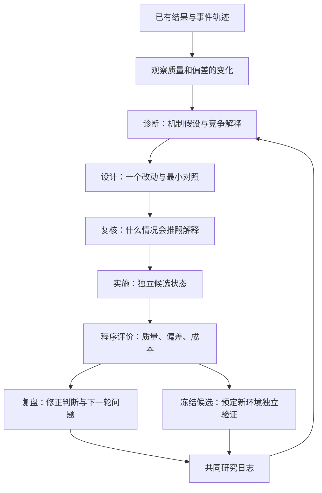

# 我们要做的：推荐系统研究员（v4）

2026-10-14。当前优先级：把研究工作流搭清楚、跑得通、讲得明白。第四版已将平铺脚本改为 `rsi_researcher/` 业务包，统一入口为 `python -m rsi_researcher`，并连接开发快环、独立验证环和共享研究日志。本轮只用固定回复检查连接，不扩大付费实验。

启动与目录概览见 [README](../README.md)，模块逐项解释见 [代码导读](代码导读.md)，与 Google 工作的明确对照见 [Google工作对照](Google工作对照.md)。文末旧版本结果单独列为历史，不能当作第四版真实模型实验。

核心任务是：**让 Agent 发现推荐优化的收益与代价，解释可能的原因，设计能区分解释的实验，根据结果修改自己的研究判断。** AgentCF 是第一个研究对象。质量提高、偏差下降是两个分别检查的目标。

文中的 B0 就是没有加新改法的原版，用来做固定参照；候选就是尝试改法的独立副本。

## 从一个已经出现的问题出发

旧六环境试运行中，平均推荐质量从 0.6525 到 0.7088，额外热门倾斜从 0.1046 到 0.1907。三个独立随机编号、各两个热门关系层按预定方式合并。这是一个研究线索：学习取得了收益，也可能付出了偏差代价。它还不能确定原因，更不能证明某个去偏方法有效。

这里的质量是 NDCG@10：用户更喜欢的物品越靠前，分数越高。额外热门倾斜比较“实际排名给热门物品的份额”和“按隐藏偏好排列时的份额”；只计多出来的正部分。因此热门本身不是错误，用户确实喜欢的热门物品也应排在前面。同分物品存在多种理想排列，旧报告已保留敏感性分析，主指标没有改。

已有结果可直接回看：`runs/researcher-brief-20261014/report.md`。这个文件从已完成测量生成，没有新模型请求。旧批次使用 60 件评价候选，新生成器按原计划使用 20 件；两版结果分开保存。

研究员应接着问：收益来自偏好学习还是额外热门倾斜？是反馈解释、共享物品笔记，还是候选位置造成的？需要什么对照才能分清？

## 主流程与各自职责



| 部分 | 做什么、为什么 | 向下一步交什么 |
|---|---|---|
| 推荐执行层 | 沿用 AgentCF 的选择、反馈、用户和物品笔记更新，作为被研究对象 | 每条事件、前后笔记、排名 |
| 诊断 Agent | 从收益与代价中提出原因，并保留其他解释 | 假设、事件编号、竞争解释、缺失证据 |
| 设计 Agent | 把解释变成能执行的对照，每次主要改一件事 | 改法、适用事件、预期方向、反证条件 |
| 反证复核 Agent | 检查对照能否分清原因，可以要求暂不执行 | 是否值得执行、理由、反例 |
| 实施程序 | 执行已实现的动作，在单独状态中运行 | 候选笔记、重放路径或新排名 |
| 独立评价程序 | 计算质量、偏差与成本；保留失败结果 | 指标与接受、拒绝或不确定的原因 |
| 独立验证环 | 冻结候选，在事先指定的新环境重新运行原版与候选 | 各环境得失、失败条件与适用范围 |
| 复盘 Agent | 解释实际结果，承认没有验证的部分，修改下一轮问题 | 本轮所得、修订解释、下一步对照 |

这些角色可以共用一个模型；当前按职责分开请求和上下文。交流通过明确的记录传递：诊断给设计，设计给复核，执行结果给复盘。推荐层不会收到评价用的隐藏偏好答案。每个角色的发言、实施结果、程序判断分别保存，意见不会自动变成实验事实。

当前入口是 `python -m rsi_researcher`。`research/workflow.py` 组织开发快环，`research/validation.py` 负责冻结候选后的验证，`research/journal.py` 关联两者；`recommenders/` 执行推荐学习，`evaluation/` 独立评分，`runtime/` 提供模型接口与预算。角色按研究职责划分，没有为了增加角色而接入新的代理平台。

第四版借鉴 Google 工作中“快速形成候选—独立检验—实验日志回流”的关系。Google 的慢环包含真实线上用户实验；我们目前只做新可控环境验证，因此不称为线上 A/B。验证过程中不重新设计候选，每个新环境生成自己的原版，不复用开发排名。验证证据进入研究历史之后，不再属于未见的最终考试；正式论文仍需另留最终测试条件。

逐条质量与偏差变化、笔记变化保存在 `candidate_evidence.json`；供角色阅读的摘要保留损失和偏差增加。相同固定原版下，相同动作可以复用结果，但会注明来源，不计为独立重复。`baseline_contract.json` 同时保留输入指纹和已知执行设置。程序完成状态与研究判断分开记录，异常或超时不能把上轮结论冒充本轮完成。

## 你的六个问题

### 1. AgentCF 只是语义层面的共同改进吗？

它用自然语言笔记表示用户兴趣和物品特征，但协同来自交互记录和共享状态：用户 A 的一次行为改变某物品笔记，用户 B 后续读到该笔记，自己的选择和更新也可能改变。语言是表示方式，日志是学习信号，共享物品是传播通道。原论文的方法章节明确包括用户与物品的共同反思和记忆更新。[AgentCF 原文](https://arxiv.org/html/2310.09233v1#S2)

所以要研究的是：行为证据被怎样解释、写进哪里、被谁读到、对后续结果有什么影响。用提示词控制“未观察是否等于不喜欢”是一种干预；修订源事件并重建受影响的后续状态，则还改变了记忆维护和传播过程。当前内核更新的是文本记忆，没有训练基础模型的权重。

### 2. bias/debias 怎么分类和可信管理？

偏差常由“数据怎样被看见、谁留下行为、模型怎样拟合这些行为”共同产生。不能直接把点击和购买当作不受曝光影响的兴趣答案。[综述](https://arxiv.org/pdf/2010.03240.pdf)

| 类型 | 人话含义 | 在本项目怎样处理 |
|---|---|---|
| 曝光偏差 | 没看见的东西没有机会被选 | 区分未观察和负反馈；知道真实抽样概率时才考虑概率加权 |
| 选择偏差 | 主动打分、点击的人不能代表所有人 | 核查数据如何收集，再决定能推广到谁 |
| 位置偏差 | 排在前面更容易被注意 | 传统点击位置与模型输入位置分别定义；当前能交换模型输入顺序作对照 |
| 流行度偏差 | 热门因已有优势获得更多机会 | 检查是否超过用户偏好所支持的程度，加入“热门确实合口味”的对照 |
| 从众偏差 | 他人的选择改变了自己的表达 | 需要相应行为或社会信息，当前不宣称已识别 |
| 归纳偏差 | 模型结构和训练目标自带倾向 | 写清模型和目标带来的假设，不能一概当坏事 |
| 不公平 | 不同用户或物品获得机会不符合选定目标 | 先定义对谁公平、按什么标准比较 |

反馈循环还会让这些倾向随时间积累。分类及论文入口以 [RecDebiasing](https://github.com/jiawei-chen/RecDebiasing) 为索引；具体方法的条件仍查原论文。

每个研究判断应说明：观察到了什么、相对什么参照、可能原因、支持与反对证据、还缺什么。证据状态可以是“支持、被削弱、不确定、未验证”，不能用一个模型置信度替代缺失的数据。当前 `diagnose.json` 和 `learn.json` 保存这些研究意见；程序评价单独保存。

去偏工具分布在数据收集、学习规则和输出排序等位置。概率加权是给容易被看见和不容易被看见的记录不同权重，需要概率来源与适用条件；探索是主动改变曝光、收集新反馈。两者都不能靠旧日志编出没发生的行为。

### 3. 多 Agent、数据集和飞轮怎么安排？

先按上面的职责分工，再检验分工是否有用。诊断提出解释，设计落实对照，复核寻找推翻它的条件，程序执行与评分，复盘更新研究记录。后面用相同工具和总预算比较单研究员、分工研究员与固定规则搜索，才能说明协作增加了什么。

数据按问题选，而非先选最大的库：

| 数据 | 用来回答什么 | 当前状态与边界 |
|---|---|---|
| 可控小环境 | 已知偏好和抽样机制时，检查诊断及干预方向 | 已实现；便于解释，真实世界代表性有限 |
| AgentCF 的 CDs 小样本 | 实际日志下的文本学习、传播与排序 | 已有本地资料；不能提供完整未曝光偏好答案 |
| 带随机曝光的数据 | 在额外的真实行为中检验去偏结论 | 候选包括 [KuaiRand](https://kuairand.com/)；尚未接入，需核查字段和语义资料 |

没有必要为了搭框架先完整重跑原论文。当前先用已验证的内核和小环境连接研究循环。

飞轮体现在下一轮**读到了开发与独立验证的研究所得，并因此改变问题或对照**。例如重排在开发条件下降低热门份额，但在“热门确实合口味”的验证条件伤害质量，下一轮应考虑“是否压低了用户真喜欢的热门”，而非把相同重排多试几次。

默认快环最多两轮，共用一个预算和最初原版。第四版离线演示再冻结候选，在两个新随机种子、两种热门与偏好关系下验证，共 4 个环境；结果写回 `journal.json` 后，再执行一轮开发。跨批次可以显式共用 `--journal`，`--history` 仍可带入指定旧档案。连接已经实现；固定回复只检查证据传递，真实模型是否因反证改变研究路线仍须实验验证。档案积累也不自动证明递归自改进。

第二版引入、当前仍保留的“下次试什么”计划包括：研究问题、实验目的、改动动作、源事件，以及主要解释和竞争解释各自预测的信号。下一轮先读取 `agenda.json`，设计者沿用或修订计划，都在 `plan_handoff.json` 留下理由。旧档案只有文字时，会把问题交给设计者重新设计，不靠关键词猜执行动作。

例如第一轮说“可能经过共享物品笔记传播，下一步切断共享”，第二轮现在能够实际执行每人自己的物品笔记；结果回来后，还可继续安排交换训练候选顺序，区分位置解释。这里说明的是流程能力，不能把演示中的固定回复当作模型已发现机制。

**查原因的对照与检验去偏改法，目的不同。** 前者记录质量与偏差怎样变化，用来区分解释；即使质量下降，也可能提供研究线索，不能直接写成“改法失败”。后者才检查质量保持与偏差下降的门槛。两类实验都保留实际分数、无效排名数量和原版，机制对照完成不等于机制已被证明。

### 4. 创新点会不会只剩 prompt？

工作流搭建先解决工程问题。要成为研究贡献，需要证明它发现、解释或修复了什么，而且比简单方案更有用。

目前值得检验的算法方向是：定位可疑的源推断，修订其反馈解释，再按实际读取依赖重建后续状态，避免只改一句笔记而留下受它影响的旧推断。程序已有重放能力，现在接入完整研究循环；其新颖性和效果仍待相关工作与对照验证。

应比较未知反馈保护、固定热门重排、只修当前状态、重建后续依赖等方案。若简单保护已足够，就应如实接受这个结论。自动研究能力还要看同预算下的有效发现、误报、区分解释所需试验和新环境表现，不能只数 Agent 或 prompt。

### 5. AgentCF 不是主流，研究说服力在哪里？

选择它的理由是状态和传播路径容易检查，适合作为首个研究场景。说服力要来自明确的问题、可复现的对照和后续跨环境或跨推荐器的证据。仅在 AgentCF 成立的结论，就先限定在 AgentCF；仓库规模不能替代这些证据。

因此框架把“提出研究问题”和“执行推荐器”分开。当前只实现了 AgentCF 这一个执行适配，其他推荐器尚未接入，不能称通用性已经验证。

### 6. 算子和选择器是什么？

算子就是一项明确可执行的改动。选择器就是决定下一次用什么改动、在哪些事件上试、先做哪项对照的办法。

| 当前动作 | 实际做法 | 适用边界 |
|---|---|---|
| 未知反馈保护 | 更改反馈解释，从同一初态重新学习 | 检验把未消费误当厌恶的影响 |
| 依赖重放修复 | 指定源事件修正解释，重建读取过它的后代 | 不补造未曝光反馈；读取依赖不是因果证明 |
| 固定热门重排 | 在原有名次成本上加前置热门程度惩罚，强度由配置固定 | 输出层对照；不是逆概率加权，可能误伤合理热门 |
| 切断物品共享 | 每个用户只读写自己的物品笔记，仍正常处理反馈 | 检查跨用户共享的作用；没有把所有学习一起冻结 |
| 交换训练候选位置 | 仅交换每次训练的两个候选，事件、反馈与评价面板相同 | 检查模型输入位置的影响；与用户界面的点击位置偏差分开 |
| 探索 | 设计新的曝光与反馈收集 | 当前仅能提出设计，旧日志上没有可执行结果 |
| 保留 | 证据不足时保持原规则 | 合法研究结论，不算改进 |

质量和偏差门槛是去偏改法的判断标准，不是选择器本身。去偏实验分别检查质量不低于原版的 99%、偏差不高于原版的 90%；学习与笔记内容证据不齐时保持“不确定”。机制对照单独记录测量，不使用这些晋升门槛宣布研究成败。模型负责提出值得试的办法，程序按实际结果判断。

## 怎样运行和查看

无密钥、无网络、无付费调用地检查两个环及验证反馈：

```powershell
python -m rsi_researcher demo --output outputs/structured-demo
```

演示根目录 `report.md` 是总览；`trials/0001`、`trials/0002` 是开发快环，`validation/report.md` 记录新环境验证，`next_discovery/trials/0001` 展示验证反馈后的一轮研究。三段共享 `journal.json`，使用同一个演示预算。

不花模型费用地回看已有结果：

```powershell
python -m rsi_researcher inspect --source runs/pilot-validated-20261013 --output runs/my-research-brief
```

以后需要真实执行一次小研究循环时使用下面的入口，**会调用付费模型**；本次没有启动这条命令：

```powershell
python -m rsi_researcher run --config configs/research_workflow.json --output runs/my-research --journal runs/journal.json
```

复用已有原版与学习前结果，可附加 `--source-arm`，例如旧 pilot 某世界的 `original_update` 目录；模型请求用于研究角色和必要的候选，基线不重训。缓存基线与后来候选不是同期确认性比较，适合开发与框架检查。

同一个候选进入独立验证，下面命令也会产生模型费用：

```powershell
python -m rsi_researcher validate --source runs/my-research --trial 0002 --protocol configs/validation.json --output runs/my-validation --journal runs/journal.json
```

`--trial` 指定实际存在的候选轮次；不指定则选择最近完成且已经执行的候选，不代表已经选出最优。依赖重放需要可迁移的根事件选择规则，当前不能直接把源环境编号带到新环境；这一情况会记录为需要补充规则。

后续一批从共同日志读取开发与验证反馈；`--history` 是额外导入旧档案的可选方式：

```powershell
python -m rsi_researcher run --config configs/research_workflow.json --output runs/my-next-research --journal runs/journal.json
python -m rsi_researcher journal --path runs/journal.json
```

先读根目录的 `report.md` 看总览。每轮位于 `trials/0001`、`trials/0002` 等目录：`agenda.json` 是待查问题和上轮计划，`plan_handoff.json` 记录是否沿用及其理由；`timeline.json` 对应各步骤，`evidence.json` 是研究角色的可见证据，`diagnose/design/review/learn.json` 是四类研究意见，`candidate_policy.json` 是实际改动，`candidate/score.json` 与 `comparison.json` 是程序评分及相对原版的变化，`archive.json` 留给下一轮。

## 历史结果与当前证据范围

v1–v3 的旧演示作为历史保留。第二版演示在 `runs/framework-v2-check-20261014/demo/report.md`，第三版在 `outputs/framework-v3-demo-complete`；固定替身回复只检查当时流程，不是第四版模型效果。第三版开始保留更具体的候选证据、复用来源与基线约定，这些能力继续保留在第四版的对应模块中。

已有真实测量的问题回看在 `runs/researcher-brief-20261014/report.md`，与离线演示分开。它报告的是旧协议下的测量线索，不能转记为新版研究角色链或双环效果。

当前已连接结构化源码、开发快环、独立验证环和有限证据回流，尚未用真实模型验证新版完整链路。策略优劣、自动生成新算法、真实探索、学习与笔记内容校准、独立正式研究结论仍未完成。首周原研究计划见 [冻结历史计划](实验执行计划.md)，其未完成研究任务不会因工程演示通过而自动完成。
